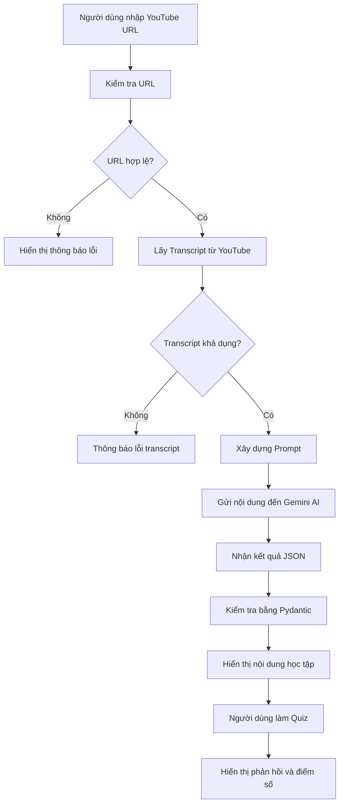

# TÀI LIỆU MÔ TẢ NGHIỆP VỤ

# YOUTUBE ENGLISH AI TUTOR

## 1. Tổng quan dự án

YouTube English AI Tutor là ứng dụng hỗ trợ người dùng học tiếng Anh thông qua video YouTube bằng cách ứng dụng trí tuệ nhân tạo (AI).

Người dùng chỉ cần nhập đường dẫn video YouTube. Hệ thống sẽ lấy nội dung transcript (bản chép lời hoặc phụ đề có sẵn), sau đó gửi nội dung đến Gemini AI để phân tích.

Dựa trên nội dung video, AI tự động tạo ra các tài liệu học tập bao gồm:

- Summary: Tóm tắt nội dung video bằng tiếng Anh và tiếng Việt.
- Vocabulary: Danh sách từ vựng quan trọng.
- Key Sentences: Những câu tiếng Anh đáng chú ý.
- Quiz: Bộ câu hỏi trắc nghiệm giúp người học kiểm tra kiến thức.

Mục tiêu của dự án là giúp người học tiết kiệm thời gian ghi chép và có thể tận dụng nội dung từ YouTube để tự học tiếng Anh hiệu quả hơn.

## 2. Mục tiêu dự án

1. Hỗ trợ người dùng học tiếng Anh thông qua video YouTube.
2. Tự động tóm tắt nội dung video bằng AI.
3. Trích xuất những từ vựng quan trọng.
4. Tổng hợp các câu tiếng Anh hữu ích.
5. Tạo bài kiểm tra để đánh giá mức độ hiểu nội dung.
6. Ứng dụng mô hình ngôn ngữ lớn (LLM) vào một sản phẩm thực tế.

## 3. Đối tượng sử dụng

| Đối tượng               | Mô tả                                                  |
| ----------------------- | ------------------------------------------------------ |
| Người mới học tiếng Anh | Người đang bắt đầu học tiếng Anh                       |
| Người tự học            | Người muốn tự học tiếng Anh tại nhà                    |
| Học sinh, sinh viên     | Người muốn cải thiện vốn từ vựng và khả năng nghe hiểu |
| Người học tiếng Anh     | Người muốn học thông qua nội dung video thực tế        |

## 4. Các chức năng chính

### 4.1. Kiểm tra YouTube URL

- Nhận đường dẫn video từ người dùng.
- Hỗ trợ URL YouTube thông thường.
- Hỗ trợ URL rút gọn.
- Hỗ trợ URL YouTube Shorts và Embed.
- Kiểm tra định dạng Video ID.

### 4.2. Lấy nội dung Transcript

- Lấy transcript có sẵn từ video YouTube.
- Yêu cầu transcript bằng tiếng Anh và tiếng Việt.
- Ghép các đoạn transcript thành một nội dung văn bản.
- Xử lý trường hợp video không có transcript khả dụng.

### 4.3. Summary – Tóm tắt nội dung

AI tạo ra:

- Bản tóm tắt bằng tiếng Anh.
- Bản tóm tắt bằng tiếng Việt.

Giúp người học nhanh chóng nắm được nội dung chính của video.

### 4.4. Vocabulary – Từ vựng

AI trích xuất từ 5–10 từ vựng quan trọng.

Mỗi từ vựng bao gồm:

- Word: Từ tiếng Anh.
- IPA: Phiên âm.
- Meaning: Nghĩa tiếng Việt.
- Example: Câu ví dụ tiếng Anh.
- Example Translation: Bản dịch tiếng Việt.

### 4.5. Key Sentences – Câu quan trọng

AI tạo đúng 5 câu tiếng Anh đáng chú ý.

Mỗi câu bao gồm:

- English: Câu tiếng Anh.
- Vietnamese: Bản dịch tiếng Việt.
- Usage: Giải thích cách sử dụng bằng tiếng Việt.

### 4.6. Quiz – Bài kiểm tra

AI tạo đúng 5 câu hỏi trắc nghiệm.

Mỗi câu hỏi bao gồm:

- Nội dung câu hỏi.
- 4 phương án trả lời.
- Đáp án chính xác.
- Giải thích bằng tiếng Việt.

Người dùng có thể chọn đáp án, xem phản hồi và kiểm tra điểm số.

## 5. Quy trình nghiệp vụ

## 6. Kiến trúc công nghệ

| Thành phần         | Công nghệ              | Vai trò                       |
| ------------------ | ---------------------- | ----------------------------- |
| Giao diện          | Streamlit              | Xây dựng giao diện người dùng |
| Ngôn ngữ lập trình | Python                 | Xử lý nghiệp vụ               |
| Transcript Service | youtube-transcript-api | Lấy transcript YouTube        |
| AI Service         | Google Gemini API      | Phân tích nội dung            |
| AI Model           | Gemini 2.5 Flash       | Sinh nội dung học tập         |
| Data Validation    | Pydantic               | Kiểm tra dữ liệu đầu ra       |
| Configuration      | python-dotenv          | Quản lý biến môi trường       |

## 7. Quy tắc nghiệp vụ

1. Người dùng phải nhập YouTube URL hợp lệ.
2. Video phải có transcript khả dụng.
3. Gemini API Key phải được cấu hình.
4. Dữ liệu AI trả về phải tuân thủ cấu trúc đã định nghĩa.
5. Vocabulary phải có từ 5–10 mục.
6. Key Sentences phải có đúng 5 mục.
7. Quiz phải có đúng 5 câu hỏi.
8. Mỗi câu hỏi Quiz có 4 phương án trả lời.
9. Phần giải thích Quiz sử dụng tiếng Việt.
10. Ngữ cảnh học tập hiện tại hướng đến trình độ tiếng Anh A2.

## 8. Dữ liệu đầu vào và đầu ra

### 8.1. Dữ liệu đầu vào

| Dữ liệu         | Mô tả                                           |
| --------------- | ----------------------------------------------- |
| YouTube URL     | Đường dẫn video do người dùng cung cấp          |
| Transcript      | Nội dung văn bản lấy từ video                   |
| Gemini API Key  | Khóa xác thực Gemini API                        |
| Learner Context | Thông tin và mục tiêu học tập được cấu hình sẵn |

### 8.2. Dữ liệu đầu ra

| Dữ liệu       | Mô tả                             |
| ------------- | --------------------------------- |
| Summary       | Tóm tắt tiếng Anh và tiếng Việt   |
| Vocabulary    | Từ vựng, phiên âm, nghĩa và ví dụ |
| Key Sentences | Câu tiếng Anh quan trọng          |
| Quiz          | Câu hỏi trắc nghiệm và đáp án     |
| Feedback      | Phản hồi và điểm số bài kiểm tra  |

## 9. Những hạn chế hiện tại

- Phụ thuộc vào transcript có sẵn trên YouTube.
- Không trực tiếp chuyển đổi âm thanh video thành văn bản.
- Không thể phân tích video không có transcript khả dụng.
- Video quá dài có thể gặp giới hạn về token, thời gian hoặc chi phí API.
- Nội dung AI tạo ra vẫn cần được kiểm tra lại.
- Thông tin người học hiện đang được cấu hình cố định.
- Chưa có hệ thống tài khoản người dùng.
- Chưa có cơ sở dữ liệu lưu lịch sử học tập.
- Chưa hỗ trợ theo dõi tiến độ học tập lâu dài.

## 10. Định hướng phát triển trong tương lai

| Chức năng                | Mô tả                                           |
| ------------------------ | ----------------------------------------------- |
| Nhiều trình độ tiếng Anh | Hỗ trợ A1, A2, B1, B2                           |
| Lịch sử học tập          | Lưu các video đã phân tích                      |
| Theo dõi tiến độ         | Lưu điểm Quiz và quá trình học                  |
| Flashcards               | Tạo thẻ ghi nhớ từ vựng                         |
| Xuất PDF                 | Xuất tài liệu học tập thành PDF                 |
| Luyện phát âm            | Hỗ trợ luyện nói và phát âm                     |
| Xử lý video dài          | Chia nhỏ transcript để phân tích                |
| Tùy chỉnh người học      | Cho phép thiết lập trình độ và mục tiêu học tập |

## 11. Kết luận

YouTube English AI Tutor là ứng dụng minh họa việc kết hợp mô hình ngôn ngữ lớn (LLM) với lĩnh vực giáo dục.

Thông qua YouTube Transcript API, Gemini AI, Streamlit và Pydantic, hệ thống có thể chuyển đổi nội dung video thành tài liệu học tiếng Anh có cấu trúc.

Dự án là nền tảng để tiếp tục phát triển các ứng dụng hỗ trợ học ngoại ngữ ứng dụng AI.
