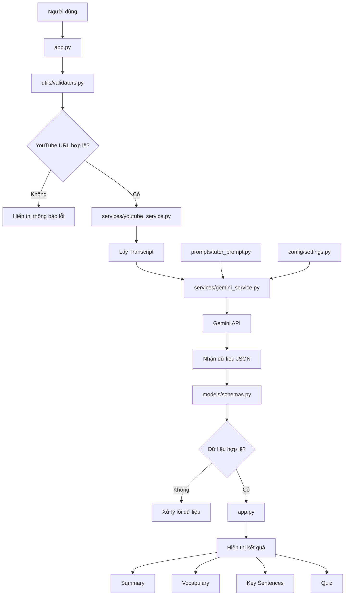

# TÀI LIỆU GIẢI THÍCH SOURCE CODE

# YOUTUBE ENGLISH AI TUTOR

## 1. Giới thiệu

Tài liệu này trình bày cấu trúc mã nguồn, chức năng của từng thư mục, từng file và luồng hoạt động của dự án YouTube English AI Tutor.

Dự án được xây dựng bằng Python, sử dụng Streamlit để phát triển giao diện người dùng và Gemini AI để phân tích nội dung video.

Source code được tổ chức theo hướng Modular Architecture (Kiến trúc module hóa), trong đó mỗi module đảm nhận một nhiệm vụ riêng biệt.

Mục tiêu của cách tổ chức này là giúp mã nguồn dễ đọc, dễ bảo trì và thuận tiện mở rộng trong tương lai.

## 2. Cấu trúc thư mục dự án

```text
youtube-english-ai-tutor/
│
├── app.py
│
├── config/
│   └── settings.py
│
├── models/
│   └── schemas.py
│
├── services/
│   ├── youtube_service.py
│   └── gemini_service.py
│
├── prompts/
│   └── tutor_prompt.py
│
├── utils/
│   └── validators.py
│
├── .env
├── .env.example
├── .gitignore
├── requirements.txt
└── README.md
```

## 3. Giải thích chức năng từng thư mục và file

### 3.1. app.py

**Vai trò:** File khởi chạy chính của ứng dụng.

Đây là file trung tâm, chịu trách nhiệm hiển thị giao diện và điều phối các hoạt động của hệ thống.

Các nhiệm vụ chính:

- Hiển thị giao diện Streamlit.
- Nhận YouTube URL từ người dùng.
- Hiển thị thông tin người học ở thanh bên.
- Kiểm tra dữ liệu đầu vào.
- Gọi các service để xử lý nghiệp vụ.
- Hiển thị kết quả do AI tạo ra.
- Xử lý tương tác với Quiz.
- Lưu kết quả phân tích trong Streamlit session state.

### 3.2. config/settings.py

**Vai trò:** Quản lý cấu hình ứng dụng.

File này chịu trách nhiệm đọc và quản lý các thông tin cấu hình từ biến môi trường.

Các nhiệm vụ chính:

- Đọc biến môi trường từ file `.env`.
- Lấy Gemini API Key.
- Cấu hình tên mô hình Gemini.
- Cung cấp thông tin cấu hình cho các thành phần khác.

Các biến cấu hình chính:

- `GEMINI_API_KEY`
- `GEMINI_MODEL`

Mô hình mặc định hiện tại: `gemini-2.5-flash`.

### 3.3. models/schemas.py

**Vai trò:** Định nghĩa cấu trúc và kiểm tra dữ liệu.

File này sử dụng thư viện Pydantic để định nghĩa các model dữ liệu mà ứng dụng sử dụng.

Các model chính:

| Model          | Chức năng                                    |
| -------------- | -------------------------------------------- |
| Summary        | Lưu nội dung tóm tắt tiếng Anh và tiếng Việt |
| VocabularyItem | Lưu từ vựng, phiên âm, nghĩa và ví dụ        |
| KeySentence    | Lưu câu tiếng Anh và phần giải thích         |
| QuizQuestion   | Lưu câu hỏi, phương án và đáp án             |
| TutorAnalysis  | Tổng hợp toàn bộ kết quả phân tích           |

Các quy tắc dữ liệu:

- Vocabulary: Từ 5 đến 10 mục.
- Key Sentences: Đúng 5 mục.
- Quiz: Đúng 5 câu hỏi.
- Mỗi câu hỏi có 4 phương án.
- Chỉ số đáp án đúng nằm trong khoảng từ 0 đến 3.

Pydantic giúp kiểm tra và chuẩn hóa dữ liệu do Gemini trả về trước khi ứng dụng sử dụng.

### 3.4. services/youtube_service.py

**Vai trò:** Xử lý việc lấy Transcript từ YouTube.

Đây là module chịu trách nhiệm kết nối với YouTube Transcript API.

Các bước xử lý:

1. Nhận Video ID.
2. Khởi tạo YouTube Transcript API.
3. Yêu cầu transcript theo danh sách ngôn ngữ tiếng Anh và tiếng Việt.
4. Lấy các đoạn transcript.
5. Ghép nội dung thành một chuỗi văn bản.
6. Trả transcript cho thành phần xử lý tiếp theo.

Nếu không lấy được transcript, service sẽ phát sinh RuntimeError để ứng dụng xử lý.

**Lưu ý:** Module này lấy phụ đề hoặc transcript có sẵn, không trực tiếp nhận diện âm thanh và chuyển thành văn bản.

### 3.5. services/gemini_service.py

**Vai trò:** Kết nối và xử lý dữ liệu với Gemini AI.

Đây là module chịu trách nhiệm giao tiếp giữa ứng dụng và mô hình ngôn ngữ lớn Gemini.

Các nhiệm vụ chính:

- Kiểm tra Gemini API Key.
- Kiểm tra transcript đầu vào.
- Chuẩn bị yêu cầu gửi đến AI.
- Gửi transcript và prompt đến Gemini.
- Yêu cầu AI trả về dữ liệu có cấu trúc JSON.
- Kiểm tra kết quả bằng TutorAnalysis.
- Trả kết quả đã được kiểm tra cho ứng dụng.

Module này đóng vai trò quan trọng trong toàn bộ quá trình phân tích nội dung video.

### 3.6. prompts/tutor_prompt.py

**Vai trò:** Quản lý Prompt Engineering.

File này định nghĩa các hướng dẫn được gửi đến Gemini AI.

Prompt cung cấp cho AI thông tin về vai trò, mục tiêu và cấu trúc kết quả mong muốn.

Thông tin người học hiện tại:

- Ngôn ngữ mẹ đẻ: Tiếng Việt.
- Trình độ tiếng Anh: A2.
- Mục đích học: Giao tiếp hằng ngày.
- Cách giải thích: Đơn giản, dễ hiểu.

Các yêu cầu AI cần thực hiện:

1. Tóm tắt nội dung video.
2. Trích xuất từ vựng quan trọng.
3. Chọn các câu tiếng Anh đáng chú ý.
4. Tạo câu hỏi trắc nghiệm.
5. Cung cấp giải thích bằng tiếng Việt.

Prompt cũng hướng dẫn AI không tự tạo thông tin không có căn cứ từ transcript.

### 3.7. utils/validators.py

**Vai trò:** Kiểm tra tính hợp lệ của YouTube URL.

Module này chứa các hàm hỗ trợ kiểm tra đường dẫn video trước khi thực hiện lấy transcript.

Các dạng URL được hỗ trợ:

- YouTube Watch URL.
- YouTube Short URL.
- YouTube Shorts URL.
- YouTube Embed URL.

Ngoài ra, module còn kiểm tra định dạng Video ID được trích xuất từ URL.

### 3.8. requirements.txt

**Vai trò:** Quản lý thư viện phụ thuộc.

File này liệt kê các thư viện Python cần thiết để chạy dự án.

Các thư viện chính:

- streamlit
- google-genai
- youtube-transcript-api
- pydantic
- python-dotenv

Cài đặt thư viện bằng lệnh:

```bash
pip install -r requirements.txt
```

### 3.9. .env và .env.example

**Vai trò:** Quản lý biến môi trường.

File `.env` lưu các thông tin cấu hình riêng của môi trường chạy ứng dụng.

Ví dụ:

```env
GEMINI_API_KEY=your_gemini_api_key
GEMINI_MODEL=gemini-2.5-flash
```

File `.env.example` cung cấp mẫu cấu hình để người khác có thể thiết lập môi trường.

Yêu cầu bảo mật:

- Không đưa API Key thật lên GitHub.
- Đưa `.env` vào `.gitignore`.
- Không viết cứng API Key trực tiếp trong source code.

### 3.10. .gitignore

**Vai trò:** Quản lý các file không đưa lên Git.

File này xác định những file hoặc thư mục cần loại trừ khi sử dụng Git.

Ví dụ:

- File `.env`.
- Thư mục `__pycache__`.
- Môi trường ảo Python.
- Các file tạm không cần thiết.

### 3.11. README.md

**Vai trò:** Tài liệu hướng dẫn dự án.

README cung cấp các thông tin cơ bản:

- Giới thiệu dự án.
- Công nghệ sử dụng.
- Hướng dẫn cài đặt.
- Hướng dẫn cấu hình môi trường.
- Hướng dẫn khởi chạy ứng dụng.
- Cách sử dụng các chức năng.

## 4. Kiến trúc tổng thể

Dự án được chia thành các lớp chức năng chính:

| Lớp                 | Thành phần          | Vai trò                           |
| ------------------- | ------------------- | --------------------------------- |
| Presentation Layer  | app.py              | Giao diện và tương tác người dùng |
| Utility Layer       | utils/validators.py | Kiểm tra dữ liệu đầu vào          |
| Service Layer       | services/           | Xử lý nghiệp vụ và kết nối API    |
| Prompt Layer        | prompts/            | Quản lý hướng dẫn gửi đến AI      |
| Data Model Layer    | models/schemas.py   | Định nghĩa và kiểm tra dữ liệu    |
| Configuration Layer | config/settings.py  | Quản lý cấu hình hệ thống         |

## 5. Luồng hoạt động của source code



## 6. Giải thích quy trình xử lý dữ liệu

### Bước 1: Người dùng nhập dữ liệu

Người dùng nhập đường dẫn video YouTube vào giao diện Streamlit.

### Bước 2: Kiểm tra URL

Ứng dụng sử dụng `utils/validators.py` để kiểm tra URL và lấy Video ID.

Nếu URL không hợp lệ, hệ thống hiển thị thông báo lỗi.

### Bước 3: Lấy Transcript

Nếu URL hợp lệ, ứng dụng gọi `services/youtube_service.py` để lấy nội dung transcript từ YouTube.

### Bước 4: Xây dựng Prompt

Nội dung transcript được kết hợp với các hướng dẫn trong `prompts/tutor_prompt.py`.

### Bước 5: Gửi dữ liệu đến Gemini AI

`services/gemini_service.py` gửi transcript và prompt đến Gemini API để phân tích.

### Bước 6: Kiểm tra kết quả

Gemini trả về dữ liệu có cấu trúc JSON.

Hệ thống sử dụng Pydantic trong `models/schemas.py` để kiểm tra dữ liệu.

### Bước 7: Hiển thị kết quả

Nếu dữ liệu hợp lệ, ứng dụng hiển thị:

- Summary.
- Vocabulary.
- Key Sentences.
- Quiz.

### Bước 8: Người dùng làm Quiz

Người dùng lựa chọn đáp án. Ứng dụng kiểm tra câu trả lời, hiển thị phản hồi và tính điểm.

## 7. Các nguyên tắc thiết kế source code

| Nguyên tắc               | Ý nghĩa                                       |
| ------------------------ | --------------------------------------------- |
| Separation of Concerns   | Mỗi module đảm nhận một nhiệm vụ riêng        |
| Modularity               | Chia source code thành các thành phần độc lập |
| Reusability              | Tái sử dụng các hàm và service                |
| Maintainability          | Dễ đọc, dễ sửa đổi và bảo trì                 |
| Data Validation          | Kiểm tra dữ liệu bằng Pydantic                |
| Configuration Management | Quản lý cấu hình thông qua biến môi trường    |

## 8. Xử lý lỗi trong hệ thống

| Trường hợp lỗi           | Cách xử lý mong muốn                         |
| ------------------------ | -------------------------------------------- |
| YouTube URL không hợp lệ | Hiển thị thông báo lỗi URL                   |
| Thiếu API Key            | Thông báo cần cấu hình API Key               |
| API Key sai              | Xử lý lỗi kết nối Gemini                     |
| Không có Transcript      | Hiển thị thông báo không lấy được transcript |
| Transcript rỗng          | Ngăn không cho thực hiện phân tích           |
| Gemini API gặp lỗi       | Hiển thị thông báo lỗi phù hợp               |
| Dữ liệu AI sai cấu trúc  | Xử lý lỗi kiểm tra Pydantic                  |

## 9. Những hạn chế kỹ thuật hiện tại

- Phụ thuộc vào transcript có sẵn trên YouTube.
- Chưa hỗ trợ nhận diện âm thanh trực tiếp.
- Video dài có thể gặp giới hạn về context hoặc API.
- Nội dung Gemini trả về có thể cần kiểm tra lại.
- Thông tin người học chưa cho phép tùy chỉnh linh hoạt.
- Chưa sử dụng cơ sở dữ liệu lưu lịch sử.
- Chưa triển khai hệ thống đăng nhập.
- Chưa có chức năng theo dõi tiến độ học tập lâu dài.

## 10. Định hướng mở rộng kiến trúc

Trong tương lai, dự án có thể được mở rộng bằng cách:

- Bổ sung Database Layer để lưu lịch sử học tập.
- Bổ sung Authentication để quản lý tài khoản người dùng.
- Cho phép người dùng tùy chỉnh trình độ tiếng Anh.
- Chia nhỏ transcript để xử lý video dài.
- Bổ sung Cache để hạn chế gọi API lặp lại.
- Bổ sung Automated Testing.
- Bổ sung chức năng xuất tài liệu PDF.

## 11. Kết luận

Dự án được xây dựng theo hướng module hóa, phân tách rõ ràng giữa giao diện, xử lý nghiệp vụ, tích hợp API, quản lý prompt, kiểm tra dữ liệu và cấu hình hệ thống.

Cách tổ chức này giúp source code dễ hiểu, dễ bảo trì và thuận tiện phát triển thêm các tính năng AI hỗ trợ học tiếng Anh trong tương lai.
